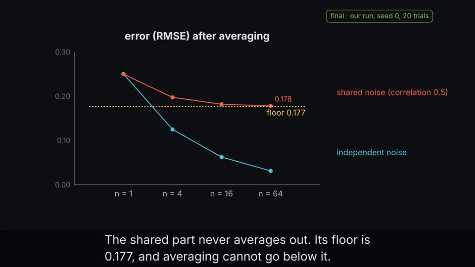
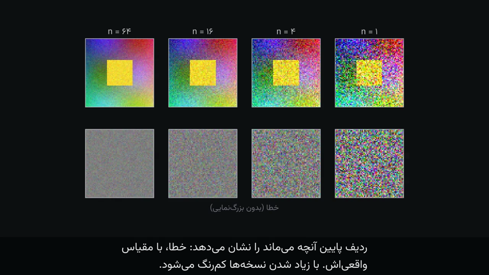

<div dir="rtl">

# research-explainer

[English](README.md) · **فارسی**

یک «مهارت» (skill) برای Claude Code که از یک کار پژوهشی **ویدئوی توضیحی به سبک 3Blue1Brown** می‌سازد، و اگر بخواهید یک
**ارائهٔ اسلایدی** هم‌خوان با آن. ویدئو می‌تواند **فارسی، انگلیسی یا هر دو** باشد. هر عددی که روی صفحه می‌آید منبع مشخص دارد و
هر تصویری که داده نشان می‌دهد از یک اجرای واقعی آمده است.

| انگلیسی، با صدای رایگان | فارسی، فقط متن |
|---|---|
|  |  |

## چه کار می‌کند؟

کافی است بگویید «از مقاله‌ام یک ویدئوی توضیحی بساز» (یا از آزمایش‌هایتان، یا از چند مقاله). Claude این کارها را می‌کند:

۱. **چند سؤال می‌پرسد:** منبع چیست، مخاطب کیست، چند دقیقه، چه زبانی، چه صدایی، اجازهٔ اجرای آزمایش دارد یا نه، و کدام نتیجه‌ها
نهایی‌اند.

۲. **همهٔ منابع را کامل می‌خواند** و یک **دفتر ادعاها** (`claims.json`) می‌نویسد: هر ادعا با وضعیتش (نهایی، توسعه، برنامه‌ریزی‌شده،
یا گزارش‌شده در مقالهٔ دیگران) و منبعش (صفحه و جدول، یا فایل و اجرا).

۳. **شکل‌ها را از دادهٔ واقعی می‌سازد:** از کد شما، لاگ‌هایتان، یا آزمایش‌های کوچک تازه. هر تصویر با اسکریپت، بذر تصادفی و
اثرانگشت فایلی که آن را ساخته ثبت می‌شود.

۴. **صحنه‌ها را به سبک 3Blue1Brown طراحی می‌کند** و پیش از نوشتن انیمیشن، طرح را به شما نشان می‌دهد.

۵. **ویدئو را با Manim می‌سازد.** اگر عددی در متن باشد که در دفتر ادعاها یا داده‌های اندازه‌گیری‌شده نیست، ساخت متوقف می‌شود.

۶. خروجی‌ها: فایل ویدئو، یک نسخهٔ کم‌حجم برای پیام‌رسان‌ها، و زیرنویس (`.srt`). از همان ادعاها و تصویرها **اسلاید** هم می‌سازد.

### گزینه‌های صدا

| گزینه | هزینه | توضیح |
|---|---|---|
| بدون صدا (فقط متن) | رایگان | زیرنویس با سرعت مناسب خواندن، با موسیقی ملایم |
| Piper | رایگان، آفلاین | انگلیسی خوب؛ برای فارسی پیش از انتخاب یک نمونه را گوش کنید |
| ضبط خودتان | رایگان | Claude متن هر قطعه را آماده می‌کند؛ خودتان ضبط می‌کنید یا از یک سایت تبدیل متن به گفتار استفاده می‌کنید |
| OpenAI | پولی، با کلید API خودتان | بهترین کیفیت برای فارسی و انگلیسی؛ هر قطعه دوباره به متن برگردانده و با متن اصلی مقایسه می‌شود |

کلید API را در فایل `~/.config/openai/key` (یا متغیر `OPENAI_API_KEY`) بگذارید. **هرگز کلید را در گفت‌وگو نچسبانید.**

### فارسیِ درست

چینش راست‌به‌چپ، رقم‌های فارسی (۰٫۲۵)، قلم وزیرمتن، ترتیب درست در سطرهای ترکیبی فارسی و لاتین (مثل «روی CIFAR-10» یا
«n = ۴»)، خواندن عددها با حروف در صدای فارسی، و سرعت زیرنویس متناسب با خواندن راحت.

## نصب

**پیش‌نیازها:** پایتون ۳٫۱۰ به بالا، [Manim Community Edition](https://docs.manim.community) و FFmpeg. اختیاری:
Piper (صدای رایگان)، LaTeX (فرمول‌ها)، کارت گرافیک انویدیا (آزمایش‌ها).

</div>

```bash
# لینوکس (Debian/Ubuntu):
sudo apt install ffmpeg libcairo2-dev libpango1.0-dev pkg-config python3-dev
# مک:
brew install ffmpeg cairo pango pkg-config
# سپس (در هر سیستم‌عاملی؛ uv را از https://docs.astral.sh/uv/ نصب کنید):
uv tool install manim
uv tool install piper-tts        # اختیاری: صدای رایگان
```

<div dir="rtl">

**روش اول: افزونهٔ Claude Code (پیشنهادی).** درون Claude Code این دو خط را بنویسید:

</div>

```
/plugin marketplace add sepi2p/research-explainer-skill
/plugin install research-explainer@research-explainer-skill
```

<div dir="rtl">

سپس یک جلسهٔ تازه باز کنید. نخستین بار که ویدئو بخواهید، Claude آماده بودن ابزارها را بررسی و قلم‌های همراه را نصب می‌کند.

**روش دوم: اسکریپت نصب.**

</div>

```bash
git clone https://github.com/sepi2p/research-explainer-skill.git
cd research-explainer-skill
./install.sh
```

<div dir="rtl">

`install.sh` مهارت‌ها را در `~/.claude/skills` و قلم‌ها را در سیستم نصب می‌کند و در پایان آماده بودن همه چیز را بررسی می‌کند.
با `--project` فقط برای پروژهٔ فعلی نصب می‌شود. با `--no-gl` مهارت اختیاری ManimGL نصب نمی‌شود، که مجوز غیرتجاری دارد.
با `--codex` در `~/.agents/skills` برای Codex شرکت OpenAI نصب می‌شود (آزموده نشده).

**روش سوم: Codex شرکت OpenAI یا نسخهٔ دسکتاپ ChatGPT.**

</div>

```bash
codex plugin marketplace add sepi2p/research-explainer-skill
codex plugin add research-explainer@research-explainer-skill
```

<div dir="rtl">

(یا `./install.sh --codex`). سپس از Codex ویدئو بخواهید، یا مهارت را با `$research-explainer` صدا بزنید. در نسخهٔ دسکتاپ
ChatGPT همین بازارچه را اضافه کنید و افزونه را از فهرست افزونه‌ها نصب کنید (هنوز آزموده نشده).

**ChatGPT در مرورگر یا موبایل** نمی‌تواند Manim را اجرا کند. در آنجا مهارت فقط برنامه‌ریزی می‌کند: پرسش‌ها، دفتر ادعاها، طرح
صحنه‌ها، متن روایت و کد صحنه‌ها. ساخت ویدئو روی رایانهٔ خودتان و با یکی از روش‌های بالا انجام می‌شود.

**می‌خواهید یک دستیار هوش مصنوعی آن را نصب کند؟** او را به فایل [AGENTS.md](AGENTS.md) ارجاع دهید.

## استفاده

Claude Code را در پوشهٔ مقاله یا پروژه‌تان باز کنید و برای نمونه بنویسید:

> از مقالهٔ `paper.pdf` یک ویدئوی توضیحی برای پژوهشگرهای حوزه‌های نزدیک بساز.

> یک ویدئوی ۱۰ دقیقه‌ای فارسی بدون صدا از آزمایش‌هایم در پوشهٔ `./runs` بساز، به‌همراه اسلاید.

> این سه مقاله در `./papers` را در یک ویدئوی ۵ دقیقه‌ای انگلیسی با صدای رایگان مقایسه کن.

Claude سؤال‌هایش را می‌پرسد، دفتر ادعاها و طرح صحنه‌ها را برای تأیید نشانتان می‌دهد و بعد ویدئو را می‌سازد. خروجی‌ها در پوشهٔ
`build` پروژه قرار می‌گیرند.

## نمونه

پوشهٔ `examples/averaging-noise` یک ویدئوی یک‌دقیقه‌ای است که از یک آزمایش کوچک و واقعی ساخته شده: «چرا میانگین‌گیری نویز را
کم می‌کند»، همراه با محدودیتش وقتی نویز نسخه‌ها همبسته است.

</div>

```bash
cd examples/averaging-noise
SK=../../skills/research-explainer/scripts
~/.local/share/uv/tools/manim/bin/python experiments/averaging.py     # هر پایتونی که numpy و pillow دارد
python3 $SK/rx.py build fa --voice none                               # فارسی، فقط متن
python3 $SK/rx.py build en --voice piper                              # انگلیسی، صدای رایگان
```

<div dir="rtl">

## وضعیت و محدودیت‌ها

- روی لینوکس با Claude Code آزموده شده است: نصب افزونه، ساخت کامل ویدئو و `rx.py selftest`.
- در Codex نسخهٔ ۰٫۱۵۴ نصب افزونه آزموده شده و هر چهار مهارت پیدا می‌شوند؛ ساخت کامل یک ویدئو با Codex هنوز آزموده نشده است.
- روی مک احتمالاً کار می‌کند. روی ویندوز آزموده نشده؛ WSL پیشنهاد می‌شود.
- چیزی کم است؟ با `rx.py request` ثبتش کنید یا یک [issue](https://github.com/sepi2p/research-explainer-skill/issues/new/choose)
باز کنید. تغییرات هر نسخه در [CHANGELOG.md](CHANGELOG.md) آمده است.
- این مهارت کار را سریع‌تر و قابل وارسی می‌کند، اما جای بازبینی نویسندگان را نمی‌گیرد. پیش از انتشار، ویدئو را ببینید و دفتر
ادعاها را بخوانید.

## مجوز

مهارت و نمونه با مجوز MIT منتشر می‌شوند. مهارت‌ها و قلم‌های همراه مجوز خودشان را دارند؛ فهرستشان در
[THIRD_PARTY.md](THIRD_PARTY.md) آمده است.

</div>
