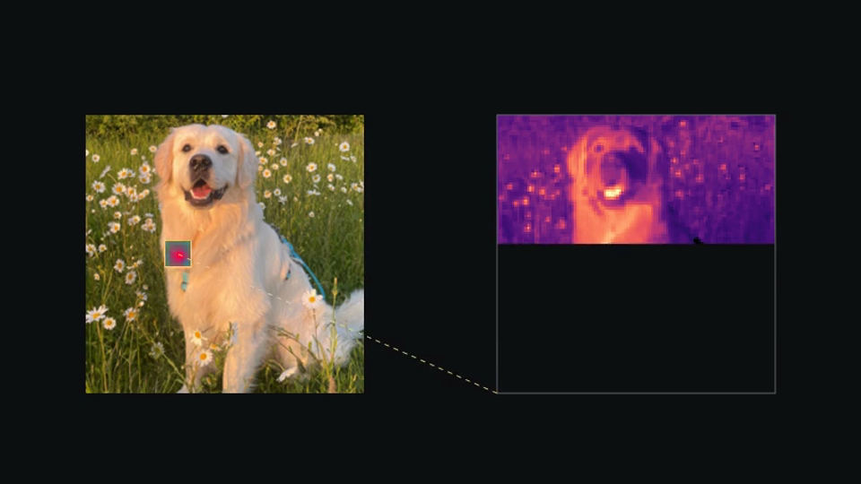
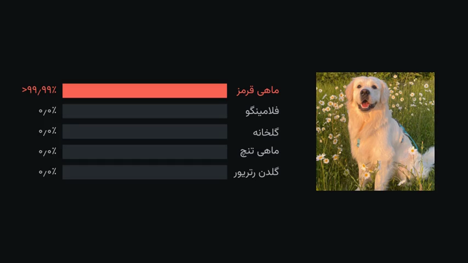
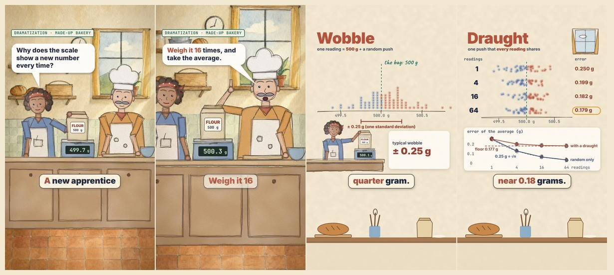

# research-explainer

**English** · [فارسی](README.fa.md)

A skill for Claude Code that turns research into a **3Blue1Brown-style explainer video**, and optionally a matching slide
deck, in **English and/or Persian (Farsi)**. Every number on screen is traced to a source, and every data image comes from a
real run. The story is told visually: things move, split, stack and transform; words are labels, and voice and subtitles
are optional layers.

| A real network's filter sweeping a photo (English) | The same network fooled by a 2/255 change (Persian) |
|---|---|
|  |  |

## What it does

You say *"make an explainer video of my paper"* (or your experiments, or a set of papers). Claude then:

1. **Asks a few questions:** what the source is, the audience, the length, the language, the voice, whether it may run
   experiments, and which results are final.
2. **Reads every source** and writes a **claims ledger** (`claims.json`): each claim with its status (final / development
   / planned / reported from another paper) and its source (page and table, or file and run).
3. **Makes the figures from real data:** your code, your logs, or small new experiments. Each image is registered with the
   script, seed and hash that produced it.
4. **Plans the scenes** in the 3Blue1Brown style, beat by beat by what moves, and shows you the plan before writing any
   animation.
5. **Checks and builds** the video with Manim. `rx.py claims` fails if any number in the narration is missing from the
   ledger or the measured data; the agent runs it before building. Then it **reviews its own frames** (contact sheets, a
   phone-size sheet), scores them on seven criteria, and fixes the worst problems until every score is 8 or more.
6. Delivers `video.mp4`, a small copy for messaging apps, and subtitles (`.srt`, or burned in if you ask). It can also make
   **slides** from the same claims and images, and a 20-30 s **launch video** (`rx.py promo`: motion graphics, music
   synthesized in code or your own track, cuts on the measured beat, landscape, vertical or square).

**Two more formats.** A hand-drawn **paper-diorama** style (a cut-paper set with a puppet and graph-paper slips of real
runs; an HTML/SVG page rendered by Playwright, `templates/diorama/`), and **vertical shorts** for YouTube Shorts or
LinkedIn (HyperFrames compositions rendered at 1080x1920 with a checked voice, timed captions and a CC0 sampled score,
`templates/short/`).

**Watercolor story shorts.** A vertical short that opens on a small painted scene with characters and then explains the
idea: an image model paints the empty set and a paper wash once, and the engine animates painted puppets in front of it
(they blink, mime their speech bubbles, react), with one narrator voice. Switch the look in one line: watercolor, paper
cut-out or hand-drawn ink. `templates/watercolor-story/`, guide in `references/style-watercolor.md`.



### Voice options
| option | cost | notes |
|---|---|---|
| none (text only) | free | captions paced for reading, quiet generated music |
| Piper | free, offline | good English; play a Persian sample before choosing it |
| your own recordings | free | Claude writes the script with one clip per beat; you record or use any TTS website |
| OpenAI (`gpt-audio-1.5`) | paid, your API key | the best English and Persian; each clip is transcribed back and checked |

Your API key goes in `~/.config/openai/key` (or `$OPENAI_API_KEY`). **Never paste a key into a chat.**

### Persian, done properly
Right-to-left layout; Persian digits (۰٫۲۵); the Vazirmatn font; mixed Persian/Latin lines ordered correctly
(`روی CIFAR-10`, `n = ۴`); numbers spoken as words; captions paced for comfortable reading.

## Install

**Requirements:** Python 3.10+, [Manim Community Edition](https://docs.manim.community), FFmpeg. Optional: Piper (free
voice), LaTeX (formulas), an NVIDIA GPU (experiments).

```bash
# Linux (Debian/Ubuntu):
sudo apt install ffmpeg libcairo2-dev libpango1.0-dev pkg-config python3-dev
# macOS:
brew install ffmpeg cairo pango pkg-config
# then (any OS; get uv from https://docs.astral.sh/uv/):
uv tool install manim
uv tool install piper-tts        # optional free voice
```

**Option A: Claude Code plugin (recommended).** Inside Claude Code, type:
```
/plugin marketplace add sepi2p/research-explainer-skill
/plugin install research-explainer@research-explainer-skill
```
Start a new session. The first time you ask for a video, Claude runs a setup check and installs the bundled fonts.

**Option B: install script.**
```bash
git clone https://github.com/sepi2p/research-explainer-skill.git
cd research-explainer-skill
./install.sh                     # skills -> ~/.claude/skills, fonts installed, then a setup check
```
Flags: `--project` installs into the current project's `.claude/skills` only. `--no-gl` skips the optional ManimGL skill,
which has a non-commercial licence. `--codex` installs into `~/.agents/skills` for OpenAI Codex (untested).

**Option C: OpenAI Codex / ChatGPT desktop.**
```bash
codex plugin marketplace add sepi2p/research-explainer-skill
codex plugin add research-explainer@research-explainer-skill
```
(or `./install.sh --codex`). Then ask Codex for a video, or call the skill with `$research-explainer`. In the ChatGPT
desktop app, add the same marketplace and install the plugin from the Plugins directory (not tested yet).

**ChatGPT on the web or mobile** cannot run Manim, so there the skill only plans: the questions, the claims ledger, the
scene plan, the narration and the scene code. You render on your computer with any of the options above.

**Having an AI agent install it?** Point it at [AGENTS.md](AGENTS.md).

## Use

Open Claude Code in the folder with your paper or project and ask, for example:

> Make an explainer video of `paper.pdf` for researchers in nearby fields.

> I want a 10-minute Persian video about my experiments in `./runs`, no voice, plus a slide deck.

> Make a 5-minute English video comparing these three papers in `./papers`, with the free voice.

Claude asks its questions and shows you the claims ledger and the scene plan before it builds. Outputs land in the
project's `build/` folder.

## Try the demos

`examples/how-a-network-sees/` (1.5 min, EN + FA): a pretrained ImageNet classifier (ResNet-18) on CC0 photos. Pixels,
its 64 learned filters sweeping the image, feature maps layer by layer, the prediction, where it looks, and a change of at
most 2/255 per pixel that turns a golden retriever into a goldfish. Two scripts make every image and number: one downloads
the photos after checking their CC0 licence, one runs the network.

```bash
cd examples/how-a-network-sees
python3 experiments/fetch_images.py && python3 experiments/network.py   # needs torch + torchvision (CPU is fine)
python3 ../../skills/research-explainer/scripts/rx.py build en --quality l
```

`examples/averaging-noise/` is a 1-minute video built from a tiny real experiment ("why averaging removes noise", including
its limit when the noise is correlated). It needs only numpy, and `rx.py selftest` builds it.

```bash
cd examples/averaging-noise
SK=../../skills/research-explainer/scripts
~/.local/share/uv/tools/manim/bin/python experiments/averaging.py     # any Python with numpy + pillow
python3 $SK/rx.py build fa --voice none                               # Persian, text only
python3 $SK/rx.py build en --voice piper                              # English, free voice
```

## What is inside

```
skills/research-explainer/      the skill: SKILL.md, references/, scripts/rx.py + explainer library, templates/, fonts
skills/manim-composer/          scene planning (bundled, MIT, by Adithya S Kolavi)
skills/manimce-best-practices/  Manim CE coding (bundled, MIT, by Adithya S Kolavi)
skills/manimgl-best-practices/  ManimGL (optional, CC BY-NC-SA 4.0, by Adithya S Kolavi after 3Blue1Brown)
examples/how-a-network-sees/    demo: a neural network, real filters and maps, an adversarial example
examples/averaging-noise/       small demo, used by rx.py selftest
.claude-plugin/                 Claude Code plugin + marketplace manifests
.codex-plugin/, .agents/         OpenAI Codex / ChatGPT plugin + marketplace manifests
install.sh, AGENTS.md           installation for people and for agents
```

## Status and limits
- Tested with Claude Code on Linux (Manim CE 0.22): plugin install, full builds, `rx.py selftest`.
- Codex CLI 0.154: plugin install tested (all four skills found). A full video made by Codex has not been tested yet.
- macOS should work. Windows is untested (WSL is recommended).
- Missing something? `rx.py request ...` logs it, or open an [issue](https://github.com/sepi2p/research-explainer-skill/issues/new/choose).
  What changed: [CHANGELOG.md](CHANGELOG.md).
- The skill makes the work faster and keeps it checkable. It does not replace the authors' review: watch the video and
  read the claims ledger before you share it.

## Licence
MIT ([LICENSE](LICENSE)) for everything except the bundled third-party skills and fonts, which keep their own licences:
see [THIRD_PARTY.md](THIRD_PARTY.md). One of them, the optional `manimgl-best-practices`, is non-commercial (CC BY-NC-SA 4.0).
